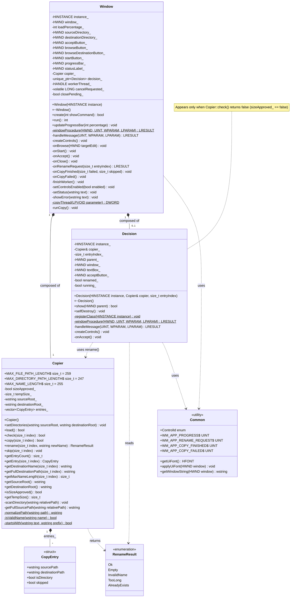

# FullCopy - Class Diagram

Class diagram of the current code (`include/` and `src/`). Everything lives in the `fullcopy` namespace.

## Notes

- **Window** owns one `Copier` and creates one `Decision` only while a name is too long (`unique_ptr`, 0..1).
- **Decision** keeps a reference to the `Copier` and calls `rename()` when the user presses *Accept*, then calls `selfDestroy()`.
- **Copier** stores the scanned files and directories as `CopyEntry` items, in pre-order (a directory always comes before its content).
- **Common** is not a class: it groups the control IDs, the messages between the copy thread and the main window, and the UI helper functions (`include/Common.hpp`).
- The copy runs on a separate thread (`Window::runCopy`). It asks for a new name with `SendMessage(WM_APP_RENAME_REQUEST)`, so it waits while the `Decision` window is open.
