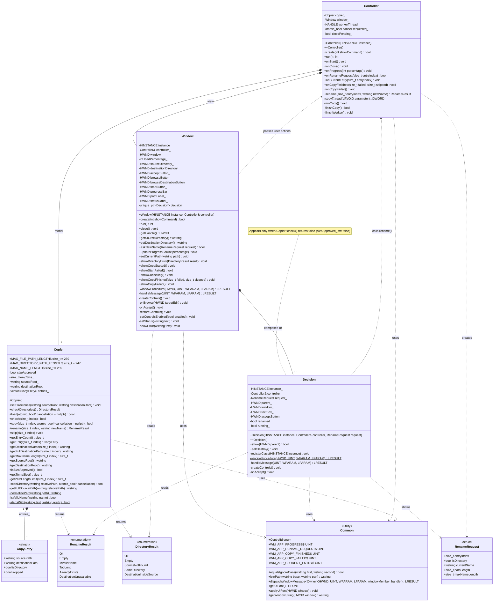

# FullCopy - Class Diagram

Class diagram of the current code (`include/` and `src/`). Everything lives in the `fullcopy` namespace.

## Notes

The code follows the Model-View-Controller pattern:

| Layer | Classes | Job |
|---|---|---|
| Model | `Copier`, `CopyEntry`, `RenameResult`, `DirectoryResult` | File system rules and data: directory checks, scanning, path limits, renames and copies. It does not know about windows. |
| View | `Window`, `Decision`, `RenameRequest` | Controls, user-visible texts and messages. They pass every user action to the `Controller` and never call the `Copier`. |
| Controller | `Controller` | Reads the input from the `Window`, calls the `Copier`, runs the copy thread, handles cancellation and tells the views what to show. |

- **Controller** owns the `Copier` and the `Window`. `main.cpp` creates only the `Controller`.
- **Window** creates one `Decision` only while a name is too long (`unique_ptr`, 0..1).
- **Decision** receives a `RenameRequest` with the data to show, and calls `Controller::rename()` when the user presses *Accept*, then calls `selfDestroy()`.
- **Copier** stores the scanned files and directories as `CopyEntry` items, in pre-order (a directory always comes before its content).
- `Copier::checkDirectories()` rejects empty directories, a missing source, and a destination equal to or inside the source before the copy starts.
- A failed or cancelled scan discards partial entries and stops the operation before files are copied. Existing destination paths must be directories, and existing files are never overwritten.
- `Controller` shares an atomic cancellation flag with `Copier`. Scanning checks it between entries, and `CopyFileExW` checks it through its progress callback.
- **Common** is not a class: it groups the control IDs, the messages between the copy thread and the main window, and the UI helper functions (`include/Common.hpp`).
- The copy runs on a separate thread (`Controller::runCopy`). It sends the `WM_APP_*` messages to the `Window`, which passes them to the `Controller` on the main thread. It asks for a new name with `SendMessage(WM_APP_RENAME_REQUEST)`, so it waits while the `Decision` window is open.
