# FullCopy - Flow Diagrams

UML activity diagrams of the current code (`src/`), drawn with Mermaid. They show what happens from
the moment the program starts until it ends, and which class does each step.

## Notation

| Symbol | Meaning |
|---|---|
| Black circle | Start of the activity. |
| Black double circle | End of the activity. |
| Circle with ✕ | End of the copy thread (flow final). |
| Rounded box | Action. It names the class and method that does it. |
| Diamond | Decision. |
| Flag | A message sent (`post`, `SendMessage`) or received between threads. |
| Dashed arrow | A message, or the shared cancellation flag, that goes from one thread to the other. |
| Frame | A thread (UML partition). |

The colors show the MVC layer of each action:

| Color | Layer | Classes |
|---|---|---|
| Blue | View | `Window`, `Decision` |
| Orange | Controller | `Controller` |
| Green | Model | `Copier` |
| Grey | Program entry | `main.cpp` |

## 1. Start and copy

The main thread runs the windows. When the user presses **Start**, the `Controller` checks the
directories with the `Copier` and starts the copy thread, which runs `Controller::runCopy()`.
The main thread keeps handling messages while the copy runs, so the window keeps responding.

```mermaid
flowchart TD
    sStart((" ")):::initial

    subgraph mainThread ["Main thread"]
        direction TB
        mInit["main: InitCommonControlsEx() and CoInitializeEx()"]:::program
        mCreate["Controller::create() → Window::create()"]:::controller
        mCreated{"Window created?"}
        mCreateError["main: show an error"]:::program
        mWait["Window: the message loop waits for the user"]:::view
        mInput["User writes or browses the directories<br/>and presses Start or Enter"]:::view
        mOnStart["Controller::onStart()"]:::controller
        mRunning{"Copy already running?"}
        mSetDirs["Controller: trim the paths<br/>Copier::setDirectories()"]:::controller
        mCheckDirs{"Copier::checkDirectories()<br/>returns Ok?"}:::model
        mDirError["Window::showDirectoryError()"]:::view
        mStarted["Window::showCopyStarted()"]:::view
        mThread["Controller: CreateThread(copyThread)"]:::controller
        mThreadOk{"Thread created?"}
        mStartFailed["Window::showStartFailed()"]:::view
        mKeep["Window: the message loop keeps running<br/>and shows the progress and the current path"]:::view
        mAccept>"WM_APP_COPY_FINISHED<br/>or WM_APP_COPY_FAILED received"]:::signal
        mDone["Controller::onCopyFinished()<br/>or Controller::onCopyFailed()"]:::controller
        mFinish["Controller::finishCopy():<br/>wait for the copy thread"]:::controller
        mPending{"Close pending?"}
        mClose["Window::close()<br/>(see diagram 3)"]:::view
        mSummary["Window::showCopyFinished()<br/>or Window::showCopyFailed()"]:::view
    end

    subgraph copyThread ["Copy thread: Controller::runCopy()"]
        direction TB
        cLoad["Copier::load(): create the destination<br/>and scan the source"]:::model
        cLoadOk{"Scan OK?"}
        cFailed>"post WM_APP_COPY_FAILED"]:::signal
        cMore{"More entries<br/>and not cancelled?"}
        cCurrent>"post WM_APP_CURRENT_ENTRY"]:::signal
        cFits{"Copier::check():<br/>does the path fit?"}:::model
        cCanRename{"Copier::getMaxNameLength() > 0<br/>and not cancelled?"}:::model
        cAsk>"SendMessage WM_APP_RENAME_REQUEST<br/>and wait (see diagram 2)"]:::signal
        cRenamed{"Renamed?"}
        cSkip["Copier::skip(): the entry<br/>and all its content"]:::model
        cCancelled{"Cancelled?"}
        cCopy["Copier::copy(): create the directory<br/>or copy the file"]:::model
        cProgress>"post WM_APP_PROGRESS<br/>if the percentage changed"]:::signal
        cEmpty{"No entries at all?"}
        cFull>"post WM_APP_PROGRESS (100)"]:::signal
        cFinished>"post WM_APP_COPY_FINISHED<br/>(failed and skipped counts)"]:::signal
        cEnd(("✕")):::flowFinal
    end

    sStop((("  "))):::final

    sStart --> mInit --> mCreate --> mCreated
    mCreated -->|no| mCreateError --> sStop
    mCreated -->|yes| mWait
    mWait --> mInput --> mOnStart --> mRunning
    mRunning -->|"yes: ignored"| mWait
    mRunning -->|no| mSetDirs --> mCheckDirs
    mCheckDirs -->|no| mDirError --> mWait
    mCheckDirs -->|yes| mStarted --> mThread --> mThreadOk
    mThreadOk -->|no| mStartFailed --> mWait
    mThreadOk -->|yes| mKeep
    mThreadOk -->|yes| cLoad
    mKeep --> mAccept --> mDone --> mFinish --> mPending
    mPending -->|yes| mClose --> sStop
    mPending -->|no| mSummary --> mWait

    cLoad --> cLoadOk
    cLoadOk -->|no| cFailed
    cLoadOk -->|yes| cMore
    cMore -->|yes| cCurrent --> cFits
    cFits -->|yes| cCancelled
    cFits -->|no| cCanRename
    cCanRename -->|yes| cAsk --> cRenamed
    cCanRename -->|no| cSkip
    cRenamed -->|"yes: check again"| cFits
    cRenamed -->|no| cSkip
    cSkip --> cCancelled
    cCancelled -->|no| cCopy --> cProgress --> cMore
    cCancelled -->|yes| cEmpty
    cMore -->|no| cEmpty
    cEmpty -->|yes| cFull --> cFinished
    cEmpty -->|no| cFinished
    cFinished --> cEnd
    cFailed --> cEnd

    cFinished -.-> mAccept
    cFailed -.-> mAccept

    classDef initial fill:#000,stroke:#000
    classDef final fill:#000,stroke:#000
    classDef flowFinal fill:#fff,stroke:#000,color:#000
    classDef view fill:#dbeafe,stroke:#1d4ed8,color:#0f172a
    classDef controller fill:#ffedd5,stroke:#c2410c,color:#0f172a
    classDef model fill:#dcfce7,stroke:#15803d,color:#0f172a
    classDef program fill:#f1f5f9,stroke:#64748b,color:#0f172a
    classDef signal fill:#fef9c3,stroke:#a16207,color:#0f172a
```

Notes:

- A skipped entry still goes through `Copier::copy()`, which does nothing for it and returns `true`.
- After a cancellation the loop stops and the thread still posts `WM_APP_COPY_FINISHED`. A
  cancellation during the scan makes `Copier::load()` fail, so the thread posts `WM_APP_COPY_FAILED`.
- The main window passes every `WM_APP_*` message to the `Controller` (`Window::handleMessage()`).

## 2. Rename an entry

This runs on the main thread when the copy thread sends `WM_APP_RENAME_REQUEST`. The copy thread
waits inside `SendMessage` until the answer comes back.

```mermaid
flowchart TD
    rStart((" ")):::initial

    subgraph mainThread ["Main thread"]
        direction TB
        rReceive>"WM_APP_RENAME_REQUEST received"]:::signal
        rOnRename["Controller::onRenameRequest()"]:::controller
        rPending{"Close pending?"}
        rRequest["Controller: fill a RenameRequest<br/>with the data of the Copier"]:::controller
        rAsk["Window::askNewName()"]:::view
        rShow["Decision::show(): modal window<br/>with the current name"]:::view
        rAction{"What does the user do?"}
        rRename["Controller::rename()"]:::controller
        rCopier{"Copier::rename():<br/>RenameResult::Ok?"}:::model
        rError["Decision::onAccept():<br/>explain the error"]:::view
        rClosed["Decision::selfDestroy()"]:::view
        rRenamed["Decision::selfDestroy()<br/>(renamed)"]:::view
        rFalse>"return FALSE:<br/>the entry is skipped"]:::signal
        rTrue>"return TRUE:<br/>the entry is checked again"]:::signal
    end

    rStop((("  "))):::final

    rStart --> rReceive --> rOnRename --> rPending
    rPending -->|yes| rFalse
    rPending -->|no| rRequest --> rAsk --> rShow --> rAction
    rAction -->|"Escape or X"| rClosed --> rFalse
    rAction -->|"Accept or Enter"| rRename --> rCopier
    rCopier -->|"no: empty, invalid, too long,<br/>already exists, unavailable"| rError --> rAction
    rCopier -->|yes| rRenamed --> rTrue
    rFalse --> rStop
    rTrue --> rStop

    classDef initial fill:#000,stroke:#000
    classDef final fill:#000,stroke:#000
    classDef view fill:#dbeafe,stroke:#1d4ed8,color:#0f172a
    classDef controller fill:#ffedd5,stroke:#c2410c,color:#0f172a
    classDef model fill:#dcfce7,stroke:#15803d,color:#0f172a
    classDef signal fill:#fef9c3,stroke:#a16207,color:#0f172a
```

Notes:

- `Copier::rename()` changes nothing when it fails, so the user can try again with another name.
- Renaming a directory also moves all its content under the new name.

## 3. Close the program

The user can close the main window at any time with the X button or Alt+F4. The **Accept** button
does the same, but it is disabled while a copy runs.

```mermaid
flowchart TD
    xStart((" ")):::initial

    subgraph mainThread ["Main thread"]
        direction TB
        xUser["User presses X, Alt+F4 or Accept"]:::view
        xReceive>"WM_CLOSE received"]:::signal
        xOnClose["Controller::onClose()"]:::controller
        xRunning{"Copy thread running?"}
        xCancel["Controller: cancelRequested_ = true<br/>and closePending_ = true"]:::controller
        xCancelling["Window::showCancelling()"]:::view
        xWaitMessage>"WM_APP_COPY_FINISHED<br/>or WM_APP_COPY_FAILED received"]:::signal
        xFinish["Controller::finishCopy():<br/>wait for the copy thread"]:::controller
        xClose["Window::close(): DestroyWindow()"]:::view
        xDestroy["Window: WM_DESTROY → PostQuitMessage()"]:::view
        xLoopEnds["Message loop ends:<br/>Controller::run() returns"]:::controller
        xCleanup["main: destroy the Controller,<br/>then CoUninitialize()"]:::program
    end

    subgraph copyThread ["Copy thread"]
        direction TB
        xStops["Sees cancelRequested_ between entries<br/>or inside CopyFileExW, and stops"]:::controller
        xPost>"post WM_APP_COPY_FINISHED<br/>or WM_APP_COPY_FAILED"]:::signal
        xThreadEnd(("✕")):::flowFinal
    end

    xStop((("  "))):::final

    xStart --> xUser --> xReceive --> xOnClose --> xRunning
    xRunning -->|no| xClose
    xRunning -->|yes| xCancel --> xCancelling --> xWaitMessage --> xFinish --> xClose
    xClose --> xDestroy --> xLoopEnds --> xCleanup --> xStop

    xCancel -.-> xStops
    xStops --> xPost --> xThreadEnd
    xPost -.-> xWaitMessage

    classDef initial fill:#000,stroke:#000
    classDef final fill:#000,stroke:#000
    classDef flowFinal fill:#fff,stroke:#000,color:#000
    classDef view fill:#dbeafe,stroke:#1d4ed8,color:#0f172a
    classDef controller fill:#ffedd5,stroke:#c2410c,color:#0f172a
    classDef program fill:#f1f5f9,stroke:#64748b,color:#0f172a
    classDef signal fill:#fef9c3,stroke:#a16207,color:#0f172a
```

Notes:

- During a copy, `Controller::onClose()` does not close the window. It is closed later, in
  `Controller::finishCopy()`, when the copy thread has ended, so the `Copier` is never destroyed
  while the thread uses it.
- Closing can take a moment: the copy thread stops at the next check of the cancellation flag.
- While the **Name too long** window is open, the main window is disabled, so it can not be closed.
